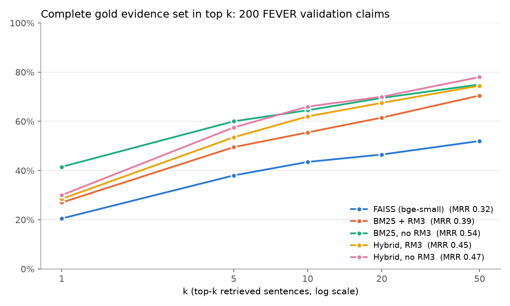
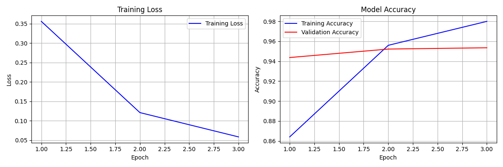

# ClaimScan (RAG + RL)

Right now this is a FEVER fact-checker. You give it a claim, it pulls evidence from a 25.2M-sentence Wikipedia corpus, scores that evidence, and a fine-tuned DeBERTa-v3 verifier says TRUE, FALSE or NOT ENOUGH INFO. A Gemma rear aggregator can then veto the verdict down to NEI.

## Where this is going

I'm still going to do RAG + RL, but I really am going to pivot the idea now a bit towards something I can actually use.

I find often when I'm reading papers, I want quick definitions over highlighted words with AI. Like 1-2 sentence definitions. I think RAG + RL (even ignoring the RL, but the RAG part) is a perfect archetype for this: a small LLM kind of thing which can define single terms or sentences for me. I highlight over the word, ask for a definition/description, and it gives it to me. That would make reading papers SO easy for me.

It's also the perfect project for me to practice my agentic coding + workflow + sys design.

## How it works

```
claim
  -> retrieval: BM25 (Lucene) / FAISS bge-small / RRF hybrid of both (k=60)
  -> neurosymbolic evidence scoring: rank prior x claim-type rules
  -> DeBERTa-v3 verifier -> TRUE / FALSE / NOT ENOUGH INFO
  -> rear aggregator (Gemma on llama.cpp, through LangChain): may veto to NEI
```

We need an LLM in the back to pick up the responses and give an answer. I give the rear aggregator veto power, so it can change the verdict to NEI if its conclusion from the most evidence disagrees with the decision. The rules:
- It only ever changes TRUE/FALSE to NEI. It never flips TRUE to FALSE or back.
- If the verifier's confidence is high (0.6 or more), don't bother flipping. Only flip if the confidence is below 0.6, or the model truly believes this is an unfactual/impossible situation (it's very sure, >= 0.9).
- It's off by default (`aggregator.enabled: false` in `configs/default.yaml`), and if the server is down you just get the verifier's verdict.

`retriever.kind` in `configs/default.yaml` picks `hybrid` (default: FAISS + BM25 without RM3), `bm25` or `faiss` (the low-memory option).

The llama.cpp side (build, serving, one config per LLM role) is walked through in [llamacpp/README.md](llamacpp/README.md).

## Layout

```
claimscan/
  data/                 build FEVER claims / evidence / corpus parquet
  retrieval/            FAISS + BM25 retrievers, RRF hybrid, index builders
  neurosymbolic_layer/  claim-type rules and evidence scoring
  evidence/             evidence selection + SQLite sentence store
  verifier/             DeBERTa model, training data prep, training
  instruct/             front decomposer + rear aggregator (LangChain)
  eval/                 recall@k, retriever benchmark, FEVER metric
  graph/                makes the plots in graphs/
  api/                  FastAPI service
  pipeline.py           load_services(), fact_check_detailed()
configs/default.yaml    all settings
llamacpp/               llama.cpp build/serve scripts, one config per LLM role
docker/                 Docker image for the API
scripts/  tests/  graphs/
```

## Run it

`requirements.txt` is just what the API needs. `requirements-dev.txt` adds training, eval, BM25, graphs and tests. BM25 (pyserini) also needs a **Java 21 JDK**, which pip can't install: `sudo apt install openjdk-21-jdk-headless`.

```bash
git clone https://github.com/mkhi238/FEVER_RAG_LLM_Model.git && cd FEVER_RAG_LLM_Model
source scripts/env.sh                   # puts caches and temp on D:/E:, not C:
uv python install 3.12 && uv venv --python 3.12 .venv
uv pip install --python .venv/bin/python -r requirements-dev.txt
uv pip install --python .venv/bin/python --no-deps -e .
```

Data and indexes live outside the repo, under `artifacts_root` in `configs/default.yaml`. Override it with `CLAIMSCAN_ARTIFACTS=/path` (or a whole config with `CLAIMSCAN_CONFIG=/path/to.yaml`).

```bash
uvicorn claimscan.api.main:app            # POST /fact-check {"claim": "..."}, GET /health
python -m claimscan.eval.benchmark --n 300                 # compare all retrievers
python -m claimscan.eval.fever_eval --max-claims 200       # end-to-end FEVER score
python -m pytest -q
```

The API uses the same `fact_check_detailed` as the benchmark (k=30, 0.5 confidence floor), so benchmark numbers are what the API does. It reads sentence text from the FEVER SQLite file (`claimscan/data/fever_db.py`) instead of loading the 4 GB corpus.

Benchmark and training runs are logged to MLflow. To browse them:

```bash
mlflow ui --backend-store-uri sqlite:////mnt/d/crisis-claim-analysis/artifacts/mlflow/mlflow.db
```

Docker: see [docker/README.md](docker/README.md).

## Graphs

### Retriever recall: complete gold evidence set in the top k



200 SUPPORTS/REFUTES claims from FEVER validation: the 300-claim benchmark sample minus its 100 NEI claims, which have no gold evidence. The y-axis is the share of claims with a full gold evidence set in the top k, which is what the FEVER score needs.
- **BM25 without RM3** is the strongest single retriever. It leads at k ≤ 10 (41% at k=1) and has the best MRR (0.54).
- **Hybrid without RM3** is best from k=10 up, reaching 78% at k=50.
- **FAISS (bge-small)** is far behind (52% at k=50), partly because its index covers only shards 0–174 of 253.
- **RM3 query expansion hurts** both BM25 and the hybrid.

All graphs are in [`graphs/`](graphs/README.md). Rebuild them with `python -m claimscan.graph.make_graphs`. They're drawn from saved results, so nothing gets retrieved or evaluated again.

### Verifier training curves



DeBERTa-v3 verifier, 3 epochs: training loss and train/validation accuracy. Take the ~95% validation accuracy with a grain of salt. It came from an **unshuffled split** and from training data that lost the line-0 evidence (see below), so it overstates real-world accuracy.

## Known limits

- **FEVER line 0 is stored as -1** (the HF loader turns the falsy 0 into -1), which is 46% of gold pairs. `claimscan/eval/gold.py` fixes it for eval; the old self-trained verifier (removed) was trained without that evidence.
- The FAISS index covers only 17.1M of the 25.2M sentences (shards 0–174 of 253). It's 26 GB, so it's memory-mapped (`retriever.mmap`).
- The verifier's 94–95% came from an unshuffled split. It says NEI with 0.995 confidence on "Obama was born in Hawaii".

## Next

- QLoRA finetuning on the aggregator model.
- Allow reasoning, and let it make decisions (like loop engineering) so it can ask for another retrieval.
- The research agent (Qwen3-4B on llama.cpp) with LoRA SFT, then GRPO, using the frozen verifier as the reward.
