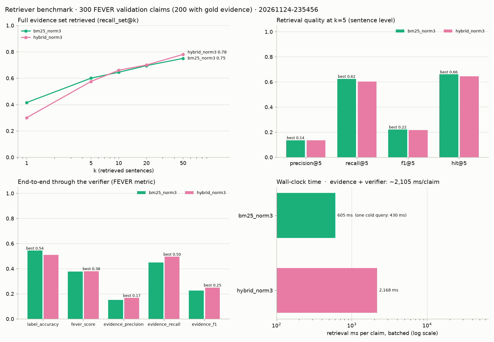
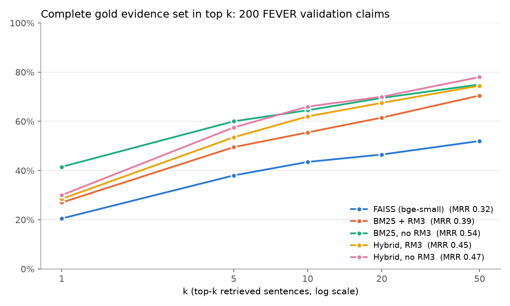
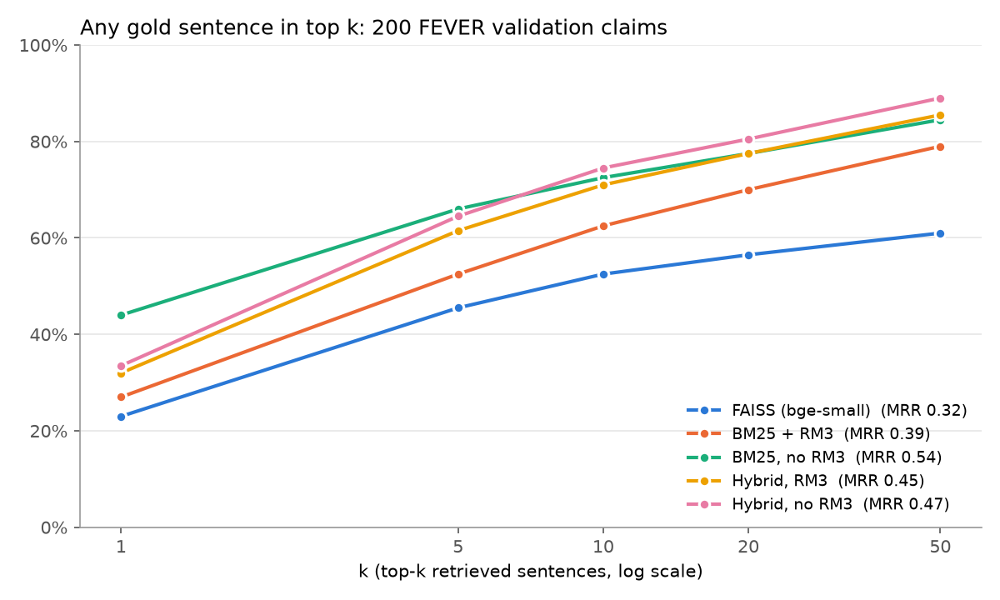
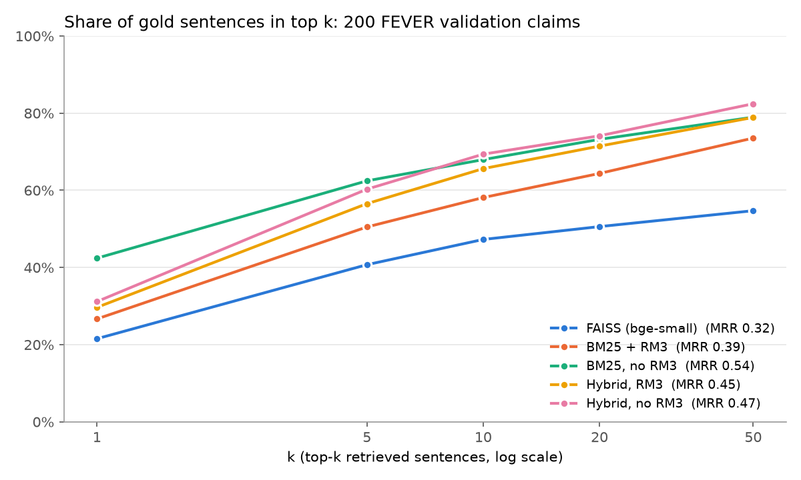
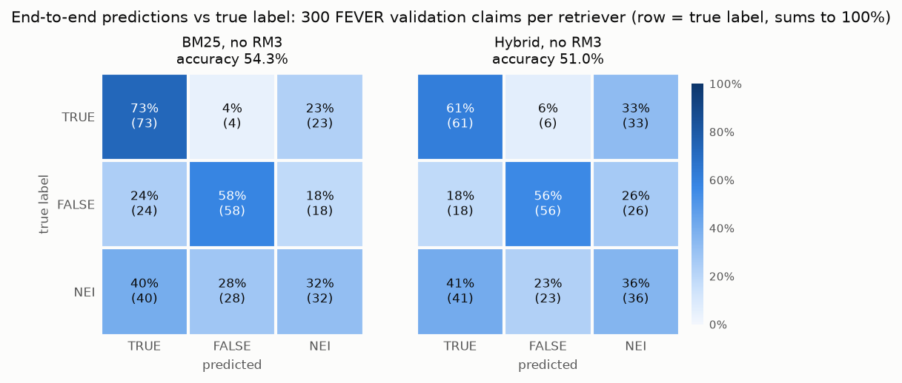
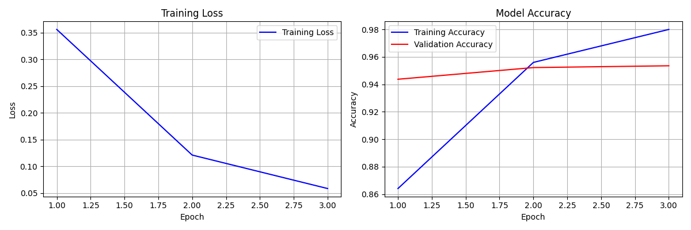

# Graphs

Generated 2026-11-25 00:25 by `python -m claimscan.graph.make_graphs` (or the `/graphs` skill). Don't edit by hand: the folder is rebuilt on every run.

## benchmark.png

Retriever benchmark summary: retrieval metrics, end-to-end FEVER metrics and time per claim.

Source: run `20261124-235456`

## retriever_recall_set.png

Share of claims with a complete gold evidence set in the top k (what the FEVER score needs).

Source: benchmark cache, 300 claims (seed 0), 200 with gold evidence

## retriever_hit.png

Share of claims with at least one gold sentence in the top k.

Source: benchmark cache, 300 claims (seed 0), 200 with gold evidence

## retriever_recall.png

Share of each claim's gold sentences found in the top k.

Source: benchmark cache, 300 claims (seed 0), 200 with gold evidence

## confusion_matrices.png

End-to-end predicted vs true label per retriever, row-normalised.

Source: run `20261124-235456`

## verifier_training_curves.png

DeBERTa verifier training loss and accuracy. Unshuffled split: overstates accuracy.

Source: copied from `/mnt/d/FEVER_RAG_LLM_Model/archive/verifier_training_curves.png` (static; regenerated only when the verifier is retrained)

### Confusion matrix numbers

| retriever | accuracy | TRUE recall | FALSE recall | NEI recall |
|---|---|---|---|---|
| BM25, no RM3 | 54.3% | 73% | 58% | 32% |
| Hybrid, no RM3 | 51.0% | 61% | 56% | 36% |
